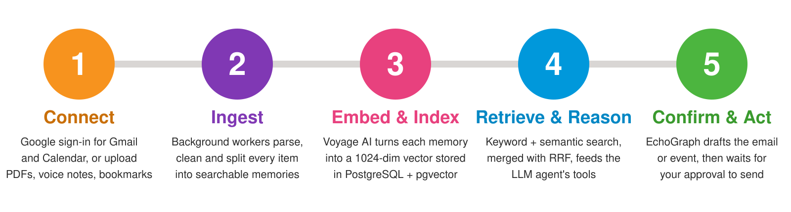
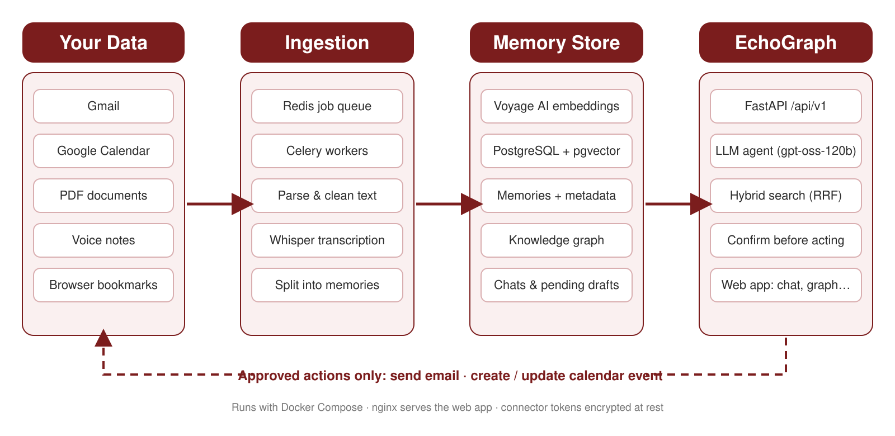
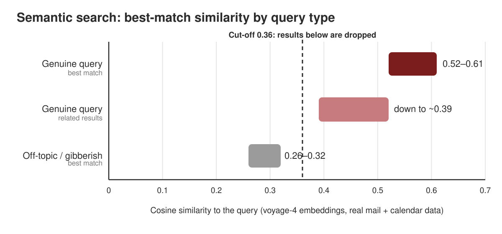
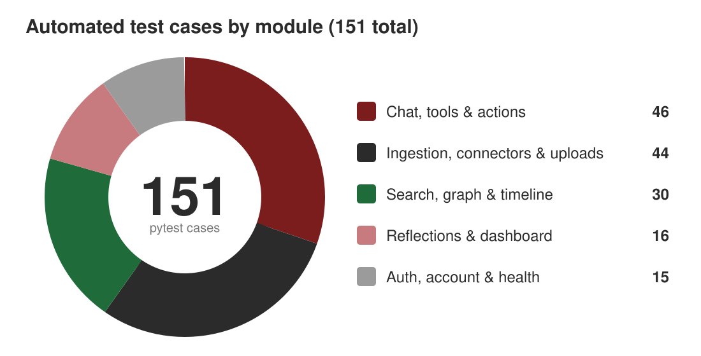

<div align="center">


<br>

[](#-open-questions--limitations)
[](LICENSE)
[](#-tested-behaviour)


**Retrieval · Knowledge graph · Confirmation-gated actions, all over your own data.**

[Idea](#-the-idea) ·
[How it works](#-how-it-works) ·
[Architecture](#-architecture) ·
[Experiments](#-experiments--findings) ·
[Run it](#-run-it) ·
[Limitations](#-open-questions--limitations)

</div>

---

## 💡 The idea

EchoGraph is a research prototype that explores one question:

> **What changes when an assistant answers from your own history (mail, calendar, documents, voice notes, bookmarks) instead of from general knowledge, and acts on your behalf only with your say-so?**

General-purpose assistants know the world but not you. The things that matter day to day
("what did I decide about the NOC?", "list my certifications", "what was that receipt from
March?") are scattered across tools and formats. EchoGraph treats a person's data as a
retrieval corpus and a graph, and studies how to make answers **grounded, cited and safe to
act on**.

### Ideas being explored

| | Idea | The bet |
|---|---|---|
| 🗄️ | **One store for vectors, relations and the graph** | At single-user scale, Postgres + `pgvector` is simpler to run and fast enough compared with a separate vector DB and graph DB. |
| 🔎 | **Hybrid retrieval** | Keyword + semantic search merged with Reciprocal Rank Fusion (RRF) beats either alone on personal-style queries. |
| 🏷️ | **Metadata-first aggregation** | Tagging items with categories and entities makes "list all my certifications" a filter instead of a fuzzy search. |
| 📎 | **Grounded answers with citations** | Retrieved memories, optionally filtered by category, date or source, go to the model together with their source references. |
| ✋ | **Confirmation-gated actions** | The agent prepares a draft and waits. Nothing is sent or changed on a connected account without explicit approval. |
| ⚡ | **Inline ingestion for uploads** | Files are parsed, chunked (~2,000 characters with overlap), embedded and stored inside the request, so the response is the final state. |
| 👁️ | **Local-first OCR** | Text in images is read on the server with Tesseract. EXIF dates become the memory's date. |
| 🪞 | **Periodic reflections** | Scheduled jobs summarise recent memory into reflections. |

---

## 🧭 How it works



1. **Connect:** sign in with Google for Gmail and Calendar, or upload PDFs, voice notes and bookmarks.
2. **Ingest:** background workers parse, clean and split every item into searchable memories.
3. **Embed & index:** Voyage AI turns each memory into a 1024-dimension vector stored in PostgreSQL + pgvector.
4. **Retrieve & reason:** keyword and semantic search are merged with RRF and feed the LLM agent's tools.
5. **Confirm & act:** EchoGraph drafts the email or event, then waits for your approval.

### The approval loop

Every action that touches a real account goes through the same four steps:


---

## 🏗️ Architecture



Pipeline: **ingest → normalise → enrich → embed → retrieve → (confirm) act.**

<details>
<summary><b>Stack at a glance</b></summary>

<br>

| Concern | Choice |
|---|---|
| API | FastAPI (async), SQLAlchemy 2, Alembic |
| Storage | PostgreSQL + `pgvector` |
| Background jobs | Celery + Redis |
| Embeddings | Voyage (`voyage-4`, 1024 dims) |
| Chat generation | Groq-hosted `openai/gpt-oss-120b` |
| Voice notes | Groq-hosted Whisper (`whisper-large-v3-turbo`) |
| Documents | pypdf, `.docx`, text/markdown, bookmark exports |
| Images | Pillow, pillow-heif, Tesseract OCR |
| Frontend | Static HTML/CSS/JS served by nginx |

</details>

<details>
<summary><b>Why these choices</b></summary>

<br>

- **FastAPI** is async-native, and ingestion and RAG code is mostly I/O-bound (API and embedding calls).
- **Postgres + pgvector** means one less service to run, operate and pay for, and it is fast enough at single-user volumes.
- **Celery + Redis** fits connector polling and ingestion (embedding, transcription), and the same broker can drive scheduled reflections.
- **psycopg3 everywhere** gives one driver for both the async app engine and Alembic's sync migrations.

</details>

See [ARCHITECTURE.md](ARCHITECTURE.md) for the full design and
[PROJECT_STRUCTURE.md](PROJECT_STRUCTURE.md) for the file map.

---

## 🔬 Experiments & findings

### Where should the semantic cut-off sit?

Semantic search always returns *something*, so a similarity floor is needed to say "I have
nothing on that." Measured on real mail and calendar data:



| Query type | Cosine similarity | Reading |
|---|---|---|
| Genuine query, best match | 0.52 – 0.61 | Clearly relevant |
| Genuine query, related results | down to ~0.39 | Still useful context |
| Off-topic / gibberish, best match | 0.26 – 0.32 | Noise |

A cut-off of **0.36** sits in the gap between the weakest real matches and the strongest noise,
so off-topic queries return nothing instead of confident-looking nonsense.

### 🧪 Tested behaviour



---

## ✅ What works today

- Auth, a dashboard, a timeline with infinite scroll, a graph view, search and chat.
- Uploads: PDF, Word, text/markdown, images, voice notes and bookmark exports.
- Settings with profile, privacy and danger-zone endpoints.
- Containerised end to end: backend, worker, Postgres, Redis and frontend.

---

## ⚠️ Open questions & limitations

- No OCR yet for *scanned PDFs* (scanned images are covered).
- The enrichment step (document categories) is not built for uploads yet.
- Retrieval quality has not been formally benchmarked beyond the similarity study above.
- WhatsApp auto-sync and Apple Notes automation are deliberately deferred: no official
  personal-account API exists, and the unofficial route carries ToS risk.
- Designed and tested at single-user data volumes only.

### 🧭 Possible next experiments

- [ ] An evaluation set for retrieval quality (recall@k on personal-style queries).
- [ ] Metadata filtering vs. pure semantic search for aggregate questions.
- [ ] Graph-aware retrieval (expanding hits along entity edges) vs. flat top-k.
- [ ] How often confirmation-gated drafts are accepted unchanged.

---

## 🚀 Run it

```bash
cp .env.example .env        # then fill in the keys you need
docker compose up --build
```

| Service | URL |
|---|---|
| Frontend | http://localhost:8080 |
| API docs | http://localhost:8000/docs |
| Health check | http://localhost:8000/api/v1/health |

<details>
<summary><b>Backend without Docker</b></summary>

<br>

```bash
cd backend
python -m venv .venv && source .venv/bin/activate   # Windows: .venv\Scripts\activate
pip install -r requirements-dev.txt
uvicorn app.main:app --reload
```

This needs a reachable Postgres with the `pgvector` extension and Redis. Secrets are read
from environment variables and are never committed; see `.env.example`.

</details>

---

## 🤝 Contributors

Built by Yashi Mishra ([@yashi-29](https://github.com/yashi-29)) together with Aditya
Kumarkhaniya. This repository starts from a fresh snapshot of the project, so earlier
per-commit history is not included here.

## 📄 License

MIT, see [LICENSE](LICENSE).
