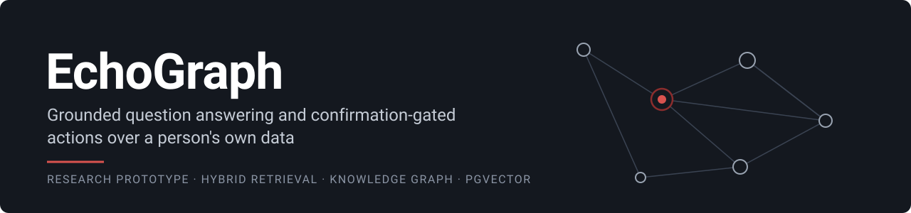
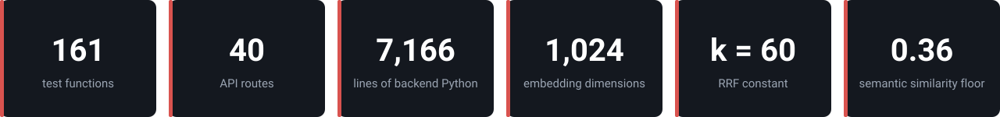
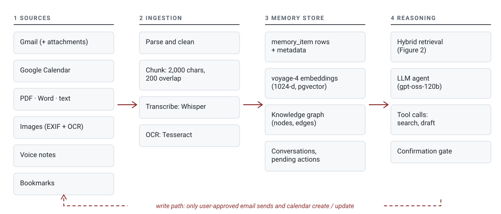
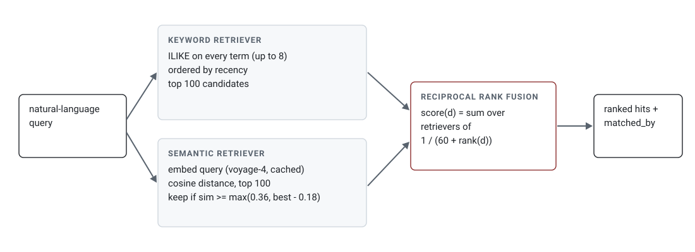
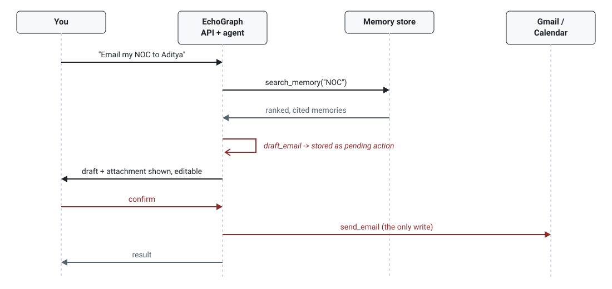
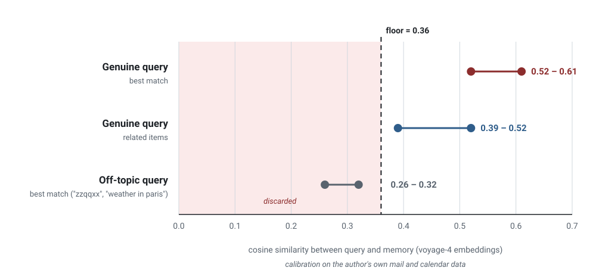
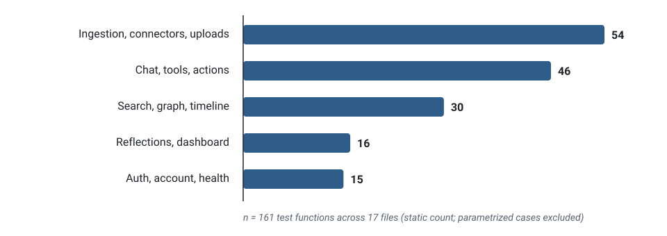
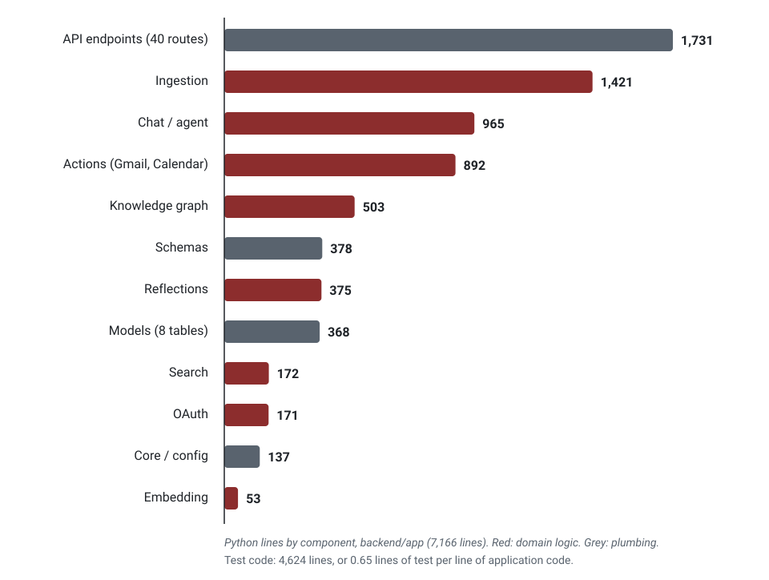

<p align="center">
  
</p>

<div align="center">

# EchoGraph

**Grounded question answering and confirmation-gated actions over a person's own data.**

[](#5-limitations-and-threats-to-validity)
[](LICENSE)
[](#32-test-suite-and-code-composition)


[Abstract](#abstract) ·
[Research questions](#1-motivation-and-research-questions) ·
[System](#2-system) ·
[Observations](#3-preliminary-observations) ·
[Limitations](#5-limitations-and-threats-to-validity) ·
[Reproduce](#7-reproducing)

<br>



</div>

---

## Abstract

General-purpose language models know a great deal about the world and almost nothing about
the person asking. The facts that matter in daily use (what was agreed in an email thread,
when a certificate was issued, which document holds a reference number) sit scattered across
mail, calendars, files, photos and voice notes. EchoGraph is a prototype for studying what it
takes to answer such questions from a user's own history rather than from the model's priors,
and to let the same system act on that history (send an email, create a calendar event)
without ever acting unprompted.

The system ingests heterogeneous sources into a single PostgreSQL database that holds
relational records, dense embeddings (`pgvector`) and a knowledge graph. Retrieval fuses a
keyword retriever and a semantic retriever with Reciprocal Rank Fusion and applies a
calibrated similarity floor so that off-topic queries return nothing instead of a confident
guess. Every write operation is staged as a pending action and runs only after explicit user
confirmation. This repository contains the implementation, the calibration measurements we
have so far, and an honest account of what has not yet been evaluated.

## 1. Motivation and research questions

Retrieval-augmented generation [1] is the standard answer to "make the model use my data",
but most published setups assume a clean document corpus. Personal data is different: it is
multi-source, mostly short and conversational, full of near-duplicates, and the cost of a
wrong answer is personal rather than abstract. Acting on that data raises the stakes further.
We organise the work around three questions.

- **RQ1.** For personal-scale corpora, is a single relational store with a vector column
  sufficient, or does the workload demand separate vector and graph databases?
- **RQ2.** How should a system decide that it has *no relevant memory*, given that nearest
  neighbour search always returns something?
- **RQ3.** What is the smallest interaction protocol that keeps an LLM agent's write
  operations under the user's control without making them tedious?

## 2. System



*Figure 1. System overview. The dashed path is the only one that writes back to an external
account, and it is gated on user confirmation (Section 2.3).*

### 2.1 Ingestion and storage

Each source is normalised into `memory_item` rows: text, source, timestamp, participants and
free-form metadata. Documents are chunked to about 2,000 characters on paragraph boundaries
with a 200-character overlap that starts on a word boundary. Images are read with Tesseract
and dated from EXIF where available; images with no text are still indexed by filename, date
and camera. Voice notes are transcribed with Whisper. Embeddings come from `voyage-4`
(1,024 dimensions) and are stored next to the relational record, so a single query can filter
by source, date or user and rank by vector distance. The knowledge graph is kept as node and
edge tables in the same database. Connector tokens are encrypted at rest.

> [!NOTE]
> This design answers RQ1 by construction, not by experiment: we chose the single-store
> option and have not yet compared it against a split architecture (see Section 5).

<details>
<summary>Software stack</summary>

<br>

| Concern | Choice |
|---|---|
| API | FastAPI (async), SQLAlchemy 2, Alembic |
| Storage | PostgreSQL with `pgvector` |
| Background jobs | Celery with Redis |
| Embeddings | Voyage `voyage-4`, 1,024 dimensions |
| Chat generation | Groq-hosted `openai/gpt-oss-120b` |
| Voice transcription | Groq-hosted Whisper (`whisper-large-v3-turbo`) |
| Documents | pypdf, `.docx`, text and markdown, Netscape bookmark exports |
| Images | Pillow, pillow-heif, Tesseract OCR |
| Frontend | Static HTML, CSS and JavaScript served by nginx |

</details>

### 2.2 Hybrid retrieval



*Figure 2. Retrieval pipeline.*

Two retrievers run for every query. The keyword retriever matches every query term (up to
eight, quoted phrases kept intact) with `ILIKE` and orders by recency. The semantic retriever
embeds the query, caches the embedding, and ranks by cosine distance. Both contribute at most
100 candidates, which are merged with Reciprocal Rank Fusion [2]:

```
score(d) = Σ over retrievers r of  1 / (60 + rank_r(d))
```

with the standard constant `k = 60`. Each hit records which retriever produced it
(`matched_by`), so the answer can be cited and the interface can show why a memory surfaced.

### 2.3 Confirmation-gated actions



*Figure 3. Interaction protocol for a write action.*

The agent has tools to search memory and to draft an email or calendar change. Drafting never
touches the external account: it stores a `pending_action` and returns it for display and
editing. The provider call (`send_email`, `create_event`, `update_event`) is reachable only
from the confirmation endpoint. This is our current answer to RQ3: one extra step for every
write, and no write without it.

## 3. Preliminary observations

### 3.1 Where to put the semantic floor (RQ2)

Nearest-neighbour search always returns a result, so an absolute similarity floor is needed
to represent "nothing relevant". We calibrated it by hand on the author's own mail and
calendar data using `voyage-4` embeddings.



*Figure 4. Observed cosine-similarity ranges. The shaded region is discarded.*

| Query type | Cosine similarity |
|---|---|
| Genuine query, best match | 0.52 – 0.61 |
| Genuine query, related items | 0.39 – 0.52 |
| Off-topic query, best match (`"zzqqxx"`, `"weather in paris"`) | 0.26 – 0.32 |

A floor of 0.36 separates the weakest genuine matches (about 0.39) from the strongest noise
(about 0.32). Because the best score varies by query, the implementation also trims the tail
adaptively: a hit is kept only if its similarity is at least `max(0.36, best − 0.18)`.

> [!CAUTION]
> These are ranges observed while tuning, not a measured distribution. The queries were few,
> hand-picked and from a single user, so the 0.36 gap should be read as a working threshold,
> not a general result. A proper study would sample queries systematically and report
> precision and recall at several floors.

### 3.2 Test suite and code composition

The backend has 161 automated test functions (static count) across 17 files.



*Figure 5. Test functions per subsystem (static count of `def test_`).*



*Figure 6. Lines of Python per backend component (7,166 lines of application code, 4,624
lines of tests). These are size measurements, not quality measurements: they say nothing
about coverage or correctness.*

## 4. Implementation status

Working: authentication, dashboard, a timeline with infinite scroll, a graph view, search and
chat; uploads of PDF, Word, text and markdown, images, voice notes and bookmark exports;
Gmail and Google Calendar ingestion; confirmed email and calendar actions; profile, privacy
and account-deletion endpoints. The stack is containerised end to end (FastAPI, Celery,
Postgres with `pgvector`, Redis, nginx).

## 5. Limitations and threats to validity

> [!WARNING]
> EchoGraph is a research prototype. Retrieval quality has not been benchmarked, and all
> tuning so far used a single user's data.

- **No retrieval benchmark.** The only retrieval measurement is the calibration in Section
  3.1. There is no labelled query set, so we cannot report recall@k, MRR, or answer quality.
- **Single user, single dataset.** All tuning used one person's mail and calendar. The floor
  and band values may not transfer to other writing styles, languages or corpus sizes.
- **RQ1 is untested.** The single-store design has not been compared with a separate vector
  and graph database on latency or recall.
- **Knowledge-graph value is unmeasured.** The graph is built and visualised, but retrieval
  does not yet use it, so we cannot claim it improves answers.
- **Scanned PDFs are not OCR'd** (scanned images are). Document-level categorisation during
  upload is not implemented.
- **WhatsApp and Apple Notes sync are deliberately out of scope.** Neither has an official
  personal-account API, and the unofficial routes carry terms-of-service risk.
- **Scale.** Everything is designed and tested at single-user data volumes.

## 6. Planned work

1. Build a labelled query set from the author's data and report recall@k and MRR for keyword
   only, semantic only, and fused retrieval.
2. Sweep the semantic floor and band and report the precision/recall trade-off.
3. Compare graph-expanded retrieval (follow entity edges from top hits) with flat top-k.
4. Measure how often a staged draft is confirmed unchanged, as a proxy for draft quality.
5. Benchmark the single-store design against a split vector/graph deployment (RQ1).

## 7. Reproducing

```bash
cp .env.example .env        # fill in the keys you need
docker compose up --build
```

The web app is served on `localhost:8080`, the API on `localhost:8000` (interactive docs at
`/docs`, health check at `/api/v1/health`). Without Docker:

```bash
cd backend
python -m venv .venv && source .venv/bin/activate   # Windows: .venv\Scripts\activate
pip install -r requirements-dev.txt
uvicorn app.main:app --reload
```

This needs Postgres with the `pgvector` extension and Redis. Secrets come from environment
variables and are never committed; see `.env.example`. Design notes are in
[ARCHITECTURE.md](ARCHITECTURE.md) and the file map is in
[PROJECT_STRUCTURE.md](PROJECT_STRUCTURE.md).

The figures in this README are generated from numbers measured on the codebase; the
calibration figure uses the ranges recorded in `backend/app/services/search.py`.

## References

1. P. Lewis et al. *Retrieval-Augmented Generation for Knowledge-Intensive NLP Tasks.*
   NeurIPS, 2020.
2. G. V. Cormack, C. L. A. Clarke, S. Büttcher. *Reciprocal Rank Fusion outperforms Condorcet
   and individual rank learning methods.* SIGIR, 2009.

## Citation

```bibtex
@software{echograph2026,
  title  = {EchoGraph: grounded question answering and confirmation-gated actions over personal data},
  author = {Mishra, Yashi and Kumarkhaniya, Aditya},
  year   = {2026},
  url    = {https://github.com/yashi-29/EchoGraph}
}
```

## Contributors

Built by Yashi Mishra ([@yashi-29](https://github.com/yashi-29)) together with Aditya
Kumarkhaniya. This repository starts from a fresh snapshot of the project, so earlier
per-commit history is not included here.

## License

MIT, see [LICENSE](LICENSE).
